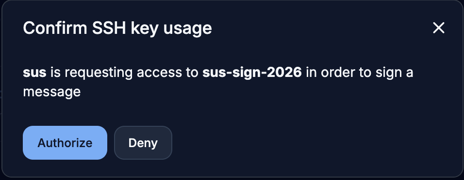

<p align="center">
  
</p>

<h1 align="center">sus</h1>

<p align="center">
  A <code>sudo</code>-like command for macOS. You approve each call in your SSH agent.<br>
  <a href="https://github.com/aNNdii/sus/actions/workflows/ci.yml"></a>
</p>

Put `sus` in front of a command and it runs as root, once you approve that one call in your
SSH agent. No password, no Admin dialog, no 5-minute timer. Yes, the name is a bit sus.
That's the point: a root tool should be boring and easy to check.

```console
$ sus id -u
0
```

<p align="center">
  
</p>

**Status:** v0.1. macOS only, tested with the Bitwarden desktop SSH agent. No external
security audit yet. Release binaries are not notarized by Apple.

## Install

```sh
mise use github:aNNdii/sus       # release archive, both binaries
cargo install --path .           # or from a checkout (Rust 1.100)
```

<details>
<summary>Downloaded the archive with a browser?</summary>

Gatekeeper stops binaries that are not notarized. Clear the flag with
`xattr -d com.apple.quarantine sus susd`, or install with `mise` or `cargo`.

</details>

## Quick start

1. Create an `ssh-ed25519` key **only for `sus`** in Bitwarden and set it to
   **"Ask for authorization: Always"**.
2. Save its public key, e.g. as `~/.ssh/laptop-sudo-sign-2026.pub`.
3. Install the service and allow your user to use that key:

   ```sh
   sudo $(mise which susd) install --key ~/.ssh/laptop-sudo-sign-2026.pub
   sus id -u    # Bitwarden asks, you approve, prints 0
   ```

Install options, the config file and other agents: [docs/configuration.md](docs/configuration.md).

## Usage

```sh
sus launchctl list
echo hi | sus cat
sus sh -c 'exit 3'; echo $?       # 3
```

- The exit code is the command's. A command killed by signal N gives 128+N.
- Ctrl-C reaches the command. Ctrl-Z and `fg` work (see [Limits](#limits)).
- No fallback: if the service, the agent or the key is missing, or you decline, `sus` prints
  one line and exits 1. It never opens an Admin dialog.
- Every call through the service is logged:
  `log show --last 1h --predicate 'subsystem == "io.github.anndii.sus"'`

## How it works

1. `sus` connects to `susd`, a root service started by launchd.
2. `susd` checks who you are and sends a fresh nonce and the keys it trusts for you.
3. `sus` asks your SSH agent to sign this exact call: nonce, your uid, the working directory
   and every argument. You approve in the agent.
4. `susd` verifies the signature, then runs the command as root on your terminal.

The private key never leaves the agent. Every call needs a new signature.
Details: [docs/architecture.md](docs/architecture.md).

## Security

- **The agent decides if a person approves.** `susd` only sees a valid signature. Set
  Bitwarden to "Ask for authorization: Always"; with OpenSSH's `ssh-agent`, add the key with
  `ssh-add -c`. Otherwise `sus` is passwordless sudo.
- **Use a key only for `sus`.** Not for logins, not for git signing, never forwarded with
  `ssh -A`.
- **The dialog does not show the command.** Bitwarden shows "sign request", not
  `rm -rf /`. If a prompt appears and you did not just run `sus`, deny it.
- **Malware running as you can ask too**, as it can with sudo. `sus` protects root from
  other users, not from your own account.
- **A signature fits one call only.** Replays and signatures for other calls, keys or tools
  are refused.
- The environment is reset as in sudo, and the config is checked on every call. Every
  request is logged; an approved one with the fingerprint of the key that signed it.

Threat model and details: [docs/security.md](docs/security.md).
Found a vulnerability? See [SECURITY.md](SECURITY.md).

## Differences from sudo

- No options. Everything after `sus` is the command, so `sus -u bob id` asks for a
  signature and then fails with `-u: command not found`.
- `PATH` is `secure_path` and `HOME` is `/var/root`. Tools in `~/.local/bin` or mise shims
  need their full path. macOS's sudo keeps your `HOME` and `PATH`.
- The command runs in launchd's system context: soft open-files limit 256, and no access to
  TCC-protected folders without Full Disk Access.
- A script without a `#!` line fails. sudo runs it with `/bin/sh`.
- A command killed by a signal gives 128+N. sudo re-raises the signal.

The full comparison with sudo, sudo-rs and passkeys (WebAuthn, CTAP), which `sus` was
reviewed against: [docs/comparison.md](docs/comparison.md).

## Limits

- macOS only. Root is the only target user; there are no per-command rules.
- No pseudo-terminal, so the command has no `/dev/tty`.
- After Ctrl-Z, type `fg` before anything else. A command that was waiting for input still
  gets the next line you type. A pty will fix this after v0.1.0.
- Nothing proves a person approved a call. Hardware-bound keys (security keys, Secure
  Enclave) are planned after v0.1.0.

## Alternatives

- **sudo with Touch ID** (`pam_tid` in `/etc/pam.d/sudo_local`): built in. Use it if one
  approval per 5 minutes is fine and you sit at the Mac.
- **[pam_ssh_agent_auth](https://github.com/jbeverly/pam_ssh_agent_auth):** a PAM module that
  lets sudo accept an agent signature. You keep sudo, its options and its timestamp cache.
- **[sudo-rs](https://github.com/trifectatechfoundation/sudo-rs):** a memory-safe sudo for
  Linux and FreeBSD.
- **`NOPASSWD` in sudoers:** no approval at all.

## Troubleshooting

- **"Operation not permitted" in `~/Documents`, `~/Desktop`, `~/Downloads` or on a USB
  drive:** that is TCC. Add `/usr/local/libexec/sus/susd` to System Settings → Privacy &
  Security → Full Disk Access.
- **`command not found` for a tool you have:** `sus` uses `secure_path`. Give the full path,
  e.g. `sus "$(command -v mytool)"`.
- **`service config invalid`:** see [docs/configuration.md](docs/configuration.md).

## Uninstall

```sh
sudo $(mise which susd) uninstall
```

Removes the service, its binary, the config and the socket. Safe to run twice.

## Contributing

Issues and pull requests are welcome. Build, test and release: [CONTRIBUTING.md](CONTRIBUTING.md).

## License

MIT, see [LICENSE](LICENSE). The crab is inspired by Ferris (public domain, rustacean.net).
