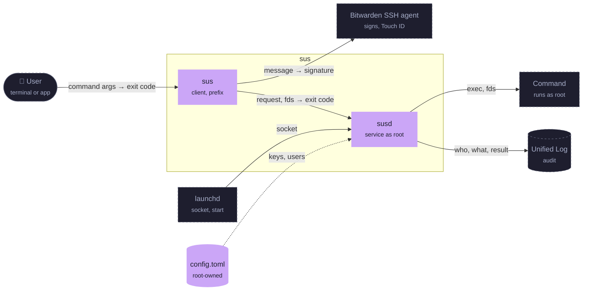
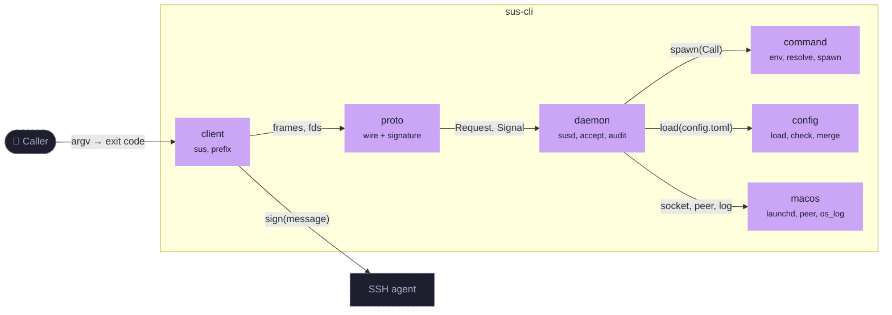
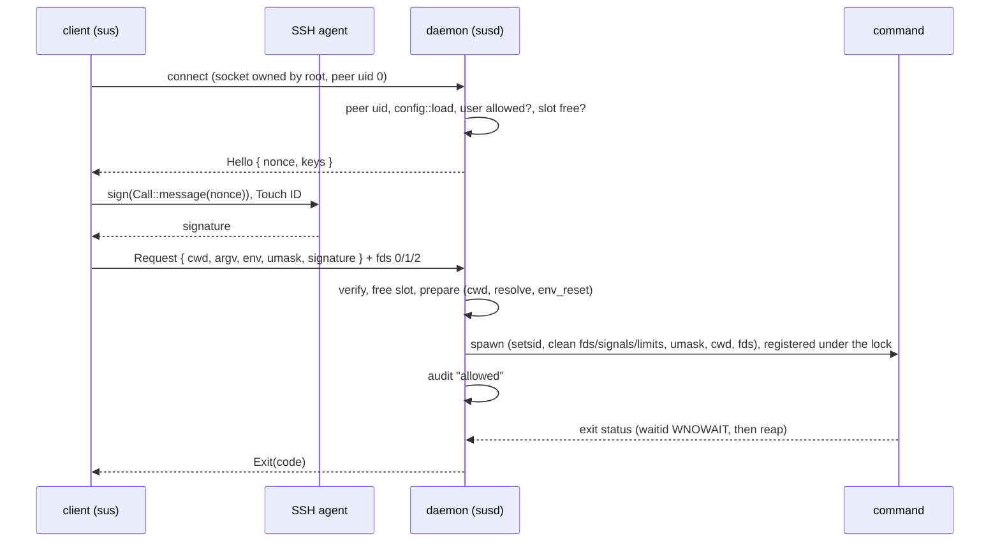
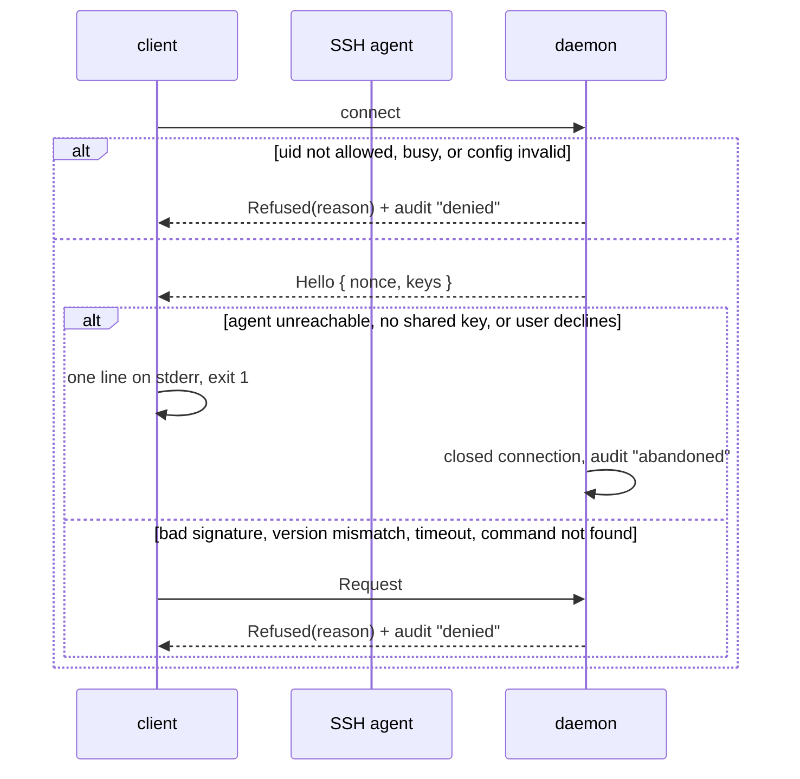
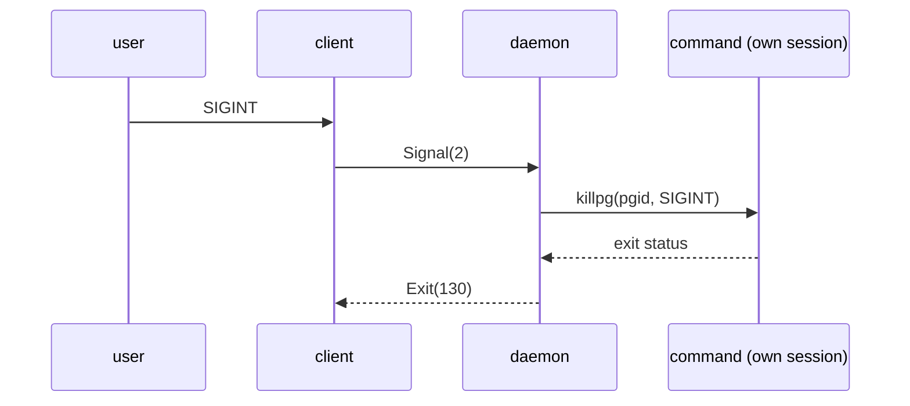
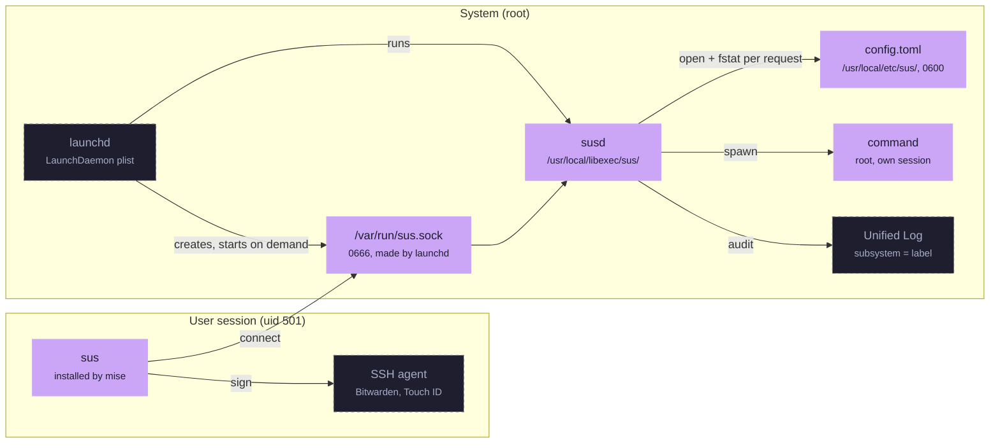
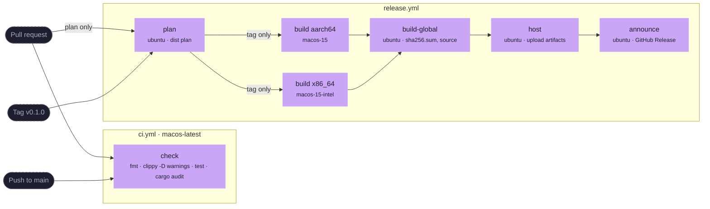
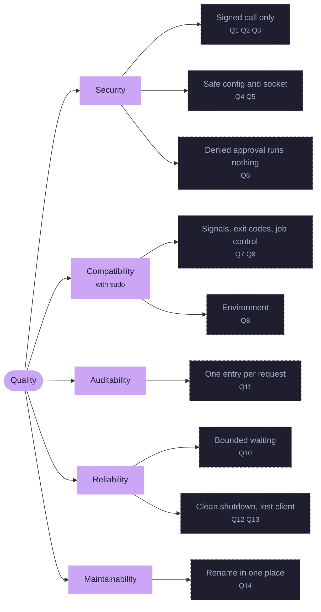

# Architecture

Structure follows [arc42](https://arc42.org) with all 12 chapters. Each architecture decision
has its own record under [`adr/`](adr/README.md); chapter 9 lists them. All names below come
from `src/names.rs`.

## 1. Introduction and goals

`sus` runs one command as root after a signature from the user's SSH agent instead of a
password. The client (`sus`) is typed in front of the command; the service (`susd`) runs as
root under launchd.

### 1.1 Requirements overview

- `sus <command> [args…]`, from a terminal or an app: one approval in the agent, then the
  command runs as root with the caller's stdin, stdout and stderr, in the caller's
  directory. The command's exit code comes back.
- `sudo susd install --key <file.pub> [--user <name>]` installs the service and adds keys;
  `sudo susd uninstall` removes everything again.
- `log show --predicate 'subsystem == "io.github.anndii.sus"'` shows who ran what.

| Goal | Meaning |
|---|---|
| Per-call approval | Each call needs its own signature; nothing is cached. |
| Key stays in the agent | The client only asks the agent to sign. |
| sudo-like behaviour | `env_reset`, exit codes, signal forwarding, config checks as in sudo. |
| Auditable | Per request a head entry plus numbered argv parts in the Unified Log, tied by `req`. |
| Renamable | All names in one file. |

Non-goals: Linux/Windows, `-u`, per-command rules, remembered approvals, a PTY, protection
against malware running as the same user.

### 1.2 Quality goals

| Priority | Quality | Goal |
|---|---|---|
| 1 | Security | Nothing runs as root without a valid signature, by a key listed for the caller, over exactly this call. |
| 2 | Compatibility with sudo | Environment, exit codes, signals and config checks behave as sudo documents them, or stricter. |
| 3 | Auditability | Every request the service handles leaves an entry: who, where, what, which key, which result. |

Chapter 10 turns these into testable scenarios.

### 1.3 Stakeholders

| Stakeholder | Expectation |
|---|---|
| User at a terminal | Types `sus` like `sudo`, approves in the agent, never types a password. |
| Apps of the user | Call `sus` without `SSH_AUTH_SOCK`; the client falls back to the Bitwarden agent socket. |
| Whoever reads the audit | Finds every request in the unified log, with key, directory and program. |
| Maintainer | A small code base, all names in one file, releases from a tag. |
| Reviewers of the code | A clear security model, a test for each rule, the reasons in the ADRs. |

## 2. Architecture constraints

### Technical

| Constraint | Background |
|---|---|
| macOS only | launchd, `getpeereid` + `LOCAL_PEERPID`, `os_log` and `launch_activate_socket` are macOS APIs. |
| launchd runs the service | A LaunchDaemon owns the socket and starts `susd` as root on demand. |
| Rust 1.100.0, edition 2024 | `rust-toolchain.toml` pins the compiler for CI and local builds; `Cargo.toml` says `rust-version = "1.100"`. |
| SSH agent protocol | The only way to the private key. The client asks the agent to list keys and to sign. |
| SSHSIG | Signature format of OpenSSH, with the namespace from `names::NAMESPACE`. |
| `ssh-ed25519` only | `install` and `config::load` accept only plain ed25519 keys: no RSA, ECDSA, `sk-*` or certificates. |
| No pty | The command gets the caller's fds and runs in its own session without a controlling terminal ([ADR 0015](adr/0015-no-pty-in-v1.md)). |

### Organisational

| Constraint | Background |
|---|---|
| MIT license | One `LICENSE` file. |
| Single maintainer | The design has to stay small enough for one person to review and release. |
| Releases through cargo-dist | One `.tar.gz` per target (aarch64, x86_64), each with both binaries, built on a version tag ([ADR 0011](adr/0011-releases-with-cargo-dist.md)). |
| Not notarized | The release binaries are not signed or notarized by Apple. A browser download needs its quarantine flag cleared. |

### Conventions

| Convention | Background |
|---|---|
| Names in `src/names.rs` | Binaries, socket, label, paths, namespace. `tests/names.rs` fails on a name literal elsewhere in `src/`. |
| sudo as the reference | Where sudo documents a behaviour, `sus` follows it or is stricter. [comparison.md](comparison.md) lists every difference. |
| Checks in CI | `cargo fmt --check`, `cargo clippy -D warnings` (with `undocumented_unsafe_blocks`), `cargo test`, `cargo audit`. |

## 3. Context and scope

### 3.1 Business context

In scope: the client, the service, its config and its installation. Outside: the SSH agent,
launchd, the command that runs and the unified log.

Purple: new. Dashed: outside.

### 3.2 Technical context

| Interface | Channel | What passes |
|---|---|---|
| Caller ↔ `sus` | Process start, fds, signals | In: argv, cwd, umask, `TERM`/`COLORTERM`/`LANG`/`LC_*`, fds 0–2, `SIGINT`, `SIGTERM`, `SIGHUP`, `SIGQUIT`, `SIGWINCH`, `SIGTSTP`. Out: exit code, one error line on stderr. |
| `sus` ↔ SSH agent | SSH agent protocol on `SSH_AUTH_SOCK`, else `~/.bitwarden-ssh-agent.sock` | List of keys; one SSHSIG signature over the call message. |
| `sus` ↔ `susd` | Unix stream socket `/var/run/sus.sock` | `Hello`, `Refused`, `Exit` to the client; `Request` with fds 0–2 (`SCM_RIGHTS`) and `Signal` to the service (see 8, Protocol). |
| `susd` ↔ launchd | LaunchDaemon plist, `launch_activate_socket`; `launchctl` at install | The listening socket; `SIGTERM` when launchd stops the service. |
| `susd` ↔ config | `/usr/local/etc/sus/config.toml`, TOML, `open` + `fstat` per request | `secure_path`, `[users]` name = [ed25519 keys]. |
| `susd` ↔ unified log | `os_log`, subsystem `io.github.anndii.sus`, `%{public}s` | Audit entries, warnings, panics. |
| `susd` ↔ command | `fork` + `exec` as root, own session | Program, argv, reset environment, cwd, umask, fds 0–2; signals to its group; exit status. |

## 4. Solution strategy

| Goal | Approach |
|---|---|
| Per-call approval | A fresh 32-byte nonce per connection; the signature covers version, nonce, uid, cwd and argv. Nothing is cached. |
| Key stays in the agent | The client only asks the agent to sign. The service holds public keys only. |
| Trust the caller's identity | The uid comes from the kernel (`getpeereid`), never from the client, and is part of the signed message. |
| Trust the service | The client checks that the socket and the peer belong to root before it asks the agent. |
| sudo-like behaviour | `env_reset`, `env_check`, `secure_path`, umask, exit codes, signal forwarding, job control and config checks mirror sudo; `tests/` and the unit tests check them (chapter 10). |
| Small attack surface | One crate, seven direct dependencies pinned with `=`, no setuid binary. `unsafe` only around libc calls and `SCM_RIGHTS` parsing, each block with a `SAFETY` comment; own `extern "C"` declarations only in `macos.rs`. |
| Auditable | One audit entry per request, written at decision time, never the signature. |
| Testable without root | A test mode when not root: own socket and config, commands run as the caller. |

## 5. Building block view

One crate, `sus-cli`, one library (`sus`) and two one-line binaries (`src/bin/sus.rs` calls
`client_main`, `src/bin/susd.rs` calls `daemon_main`).

`install` (install and uninstall) and `names` (all names) are not drawn: `install` uses
`config` and `macos`; every module uses `names`.

| Module | Responsibility |
|---|---|
| `names` | Binaries, socket, label, paths, SSHSIG namespace, test env variable names. |
| `proto` | Frames, fd passing (`SCM_RIGHTS`), size limits, `Call::message`, `sign`, `verify`, env filter rule. |
| `config` | `load` (open + fstat, like sudo), `check_chain` (install only), `merge`, `Layout`. |
| `command` | `resolve` (secure_path), `env` (env_reset, `SUDO_*`), `prepare` (cwd check, lookup, env, `setsid` and the clean process state in `pre_exec`; before any lock), `Prepared::spawn` (only fork and exec, under the lock of the running calls), `exit_code`. |
| `client` | Socket check, agent lookup, key choice, signing, signal forwarding. |
| `daemon` | Accept loop, slots, approval window, reap-safe wait, SIGTERM fan-out, audit, `install`/`uninstall` dispatch. |
| `install` | Copy binary, write config and plist, load or unload through `launchctl`. |
| `macos` | FFI only: `launch_activate_socket`, `getpeereid` + `LOCAL_PEERPID`, `os_log`. |

## 6. Runtime view

### Successful call

### Refusal

A refusal before the request is read has no argv in the audit entries (`argv=[]`). A client
that closes before sending a request gets no answer; its entries say `result=abandoned`.

### Ctrl-C

The client handles `SIGINT`, `SIGTERM`, `SIGHUP`, `SIGQUIT` and `SIGWINCH` itself and
forwards them; the command is in its own session and never sees the terminal's signal.

### Job control

The command is in its own session, so the terminal would stop only the client and a
running command would go on reading keystrokes meant for the shell. The client does job
control for it, like sudo without a pty:

- Ctrl-Z (`SIGTSTP` to the client): `Signal(SIGSTOP)` to the command's group, then the
  client stops itself (`SIGSTOP`, which nothing can ignore). Continued in the foreground
  (`fg`): `Signal(SIGCONT)`.
- Background job on the terminal on stdin (`sus cmd &`, `bg`): the client stays stopped
  until it is the terminal's foreground group, before it even asks the agent. No terminal
  on stdin (`sus cmd </dev/null &`) runs in the background as usual.
- The daemon relays only `SIGSTOP` and `SIGCONT` beyond the forwarded signals.
- Gap: on macOS a process stopped while blocked in `read()` on a terminal still takes
  the next input when it arrives and gets it after `SIGCONT`. Under sudo without a pty
  the terminal's background check (`SIGTTIN`) stops that read first, but the terminal is
  not the command's controlling terminal here, so that check does not apply. So the first
  input after Ctrl-Z (usually one line) goes to the command. A pty for the command (as
  sudo's `use_pty`) closes it; planned after v0.1.0.
- macOS reports a stopped child to `waitid(WEXITED)` too; the daemon takes such reports
  with `WSTOPPED` (never reaps) and keeps waiting, so a stopped command stays signalable.

### Connection loss

- Client gone while a command runs: the daemon sends `SIGHUP`, then `SIGCONT` (a stopped
  group sees the hang-up only once continued), to the command's group.
- Client gone during signing: the daemon drops the request and audits it as `abandoned`;
  nothing runs.
- Service gone before `Exit`: the client prints
  `connection to service lost, command state unknown`, exit 1.
- `SIGTERM` to the service (launchd): `SIGHUP` and `SIGCONT` to all live groups, wait up
  to 5 s, exit 0.
  No `SIGKILL`.
- Panic in the service (a bug): a panic hook writes location and message to the unified
  log (and stderr in test mode), then takes the `SIGTERM` path. No `catch_unwind`.
- No thread for a request: refused as busy and audited. No thread to forward a running
  command's signals: the command's group gets `SIGHUP` and a warning is logged.

## 7. Deployment view

### On the Mac

Mauve fill: part of this project · dashed: outside

| Path | Owner | Mode | Purpose |
|---|---|---|---|
| `/usr/local/libexec/sus/` | root:wheel | 0755 | Directory for the service binary. |
| `/usr/local/libexec/sus/susd` | root:wheel | 0755 | Copy of the service binary. |
| `/usr/local/etc/sus/` | root:wheel | 0755 | Config directory. |
| `/usr/local/etc/sus/config.toml` | root:wheel | 0600 | `secure_path`, `[users]` name = [ed25519 keys]. |
| `/Library/LaunchDaemons/io.github.anndii.sus.plist` | root:wheel | 0644 | LaunchDaemon with the socket. |
| `/var/run/sus.sock` | root:daemon | 0666 | Socket made by launchd; anyone may connect, the service decides. |

`sus` itself is installed by the user's tool (for example `mise`), not by `susd install`.

`susd install --key [--user]` rewrites an existing `config.toml` (`config::merge`): each named
user gets each given key it does not have yet; the content is kept, but comments and the order
of entries are not. It refuses a `secure_path` that `load` would refuse, and `users` that is
not a table. `--user` alone is refused. `susd install` without `--key` leaves the file
untouched.

### Build and release

Two workflows. `ci.yml` checks every pull request and every push to `main` on one macOS
runner: the code is macOS-only (launchd, `getpeereid`/`LOCAL_PEERPID`, `os_log`) and the
tests run service, client and an `ssh-agent` for real. `rust-toolchain.toml` pins the
compiler (1.100.0 with rustfmt and clippy) for CI and local builds alike; clippy and the tests
run `--locked`, and `cargo audit` checks `Cargo.lock` against the RustSec advisories. The repo is public, so macOS minutes
cost nothing. `release.yml` is generated by `dist generate` from `dist-workspace.toml`; only
its two build jobs need macOS, the rest plans, hashes and uploads on Ubuntu.

Mauve fill: job · dashed: trigger

| Trigger | Runs | Result |
|---|---|---|
| Pull request | `check` (macOS), `plan` (Ubuntu) | Checks pass or fail; nothing is built |
| Push to `main` | `check` | Checks on the merged state |
| Version tag (`v0.1.0`) | `plan`, both builds, `build-global`, `host`, `announce` | GitHub Release with both archives and checksums |

`ci.yml` does not run on tags, so a release builds even if the tagged commit is red: tag
only commits on `main` whose `check` passed. A branch rule on `main` that requires `check`
makes the checks block merges.

## 8. Cross-cutting concepts

### Security model

- **Peer identity.** The daemon takes the caller's uid from `getpeereid`, never from the
  client, and puts it in the signed message. Uids not in `users` are refused before a slot
  is used.
- **Keys per user.** `Hello` lists only the caller's keys, and only they verify its
  signature; another user's key in the config signs nothing for it.
- **Server identity.** The client `lstat`s the socket (must be a socket owned by uid 0) and
  checks `getpeereid` == 0 before it asks the agent to sign anything.
- **Signed message.** `magic | VERSION | nonce(32) | uid | lp(cwd) | argc | lp(arg)*`,
  integers big-endian, strings as length-prefixed raw bytes (no UTF-8 required), wrapped in
  SSHSIG with the namespace from `names::NAMESPACE`. The nonce is new per connection.
  A relative cwd is refused even when signed: it would name a directory under the
  service's cwd, not the caller's. NUL bytes in argv, cwd or env make the request fail
  before anything runs (std refuses them rather than cutting at them).
- **Unsigned input.** The environment is not signed; it is filtered by one shared rule
  (`TERM`, `COLORTERM`, `LANG`, `LC_*`, never `DYLD_*`) on both sides, `proto::filter_env`.
  As in sudo's `env_check`, a value with `/` or `%` or a leading `()` is dropped (path,
  format string, bash function), a name containing `=` never passes, and for a repeated
  name only the first value counts (if it fails, the name is gone), so `execve` gets at
  most one per name. `SUDO_COMMAND` is
  the resolved path, a space and the arguments joined by spaces, the arguments part cut
  after 4096 raw bytes (possibly inside a UTF-8 sequence) as in sudo: argv and environment
  share `ARG_MAX`, so a full copy would make a request near the 1 MiB limit fail with
  `E2BIG`. The caller's umask travels unsigned in `Request` too; the command gets
  `022 | (umask & 0777)`, so it can only tighten, as in sudo.
- **Process state of the command.** `pre_exec` (after `setsid`, only async-signal-safe or
  plain system calls) gives it sudo's clean slate: `FD_CLOEXEC` on every fd from 3 up to
  the `RLIMIT_NOFILE` soft limit (at most 65536; `fcntl`, not `close`, so std's exec-error
  pipe keeps working), all dispositions `SIG_DFL` and an empty signal mask (std resets
  neither, and `SIG_IGN` and the mask survive `exec`), `RLIMIT_CORE` 0/0 and the umask above.
  Before the fork, `macos::before_fork` makes sure libnotify's state exists: libSystem's
  fork handler reads it in the child, and a fork while another thread is still creating it
  (first `getpwnam` of the process) kills the child with SIGKILL ("os_once_t is corrupt").
- **Config.** Loaded on every request: `open`, then `fstat` on the descriptor. Must be a
  regular file owned by root, not world-writable, not group-writable unless gid 0. Every
  `secure_path` entry must be absolute (no empty, `.` or `bin` entries): `resolve` checks a
  relative entry against the service's cwd, but the command would run in the caller's.
  Failure: `service config invalid: <reason>`, audited, the service keeps running.
  `install` additionally checks the directory chain up to `/`.
- **Limits.** 4 pending requests, 30 s approval window, 1 MiB request, 65536 args, 8 KiB
  signature. Slots are taken on accept and freed right after verification.
- **Audit.** The unified log cuts a message after about 1 KiB, so each request writes
  several entries below 1000 bytes, tied together by a per-process counter `req`. First
  `req=N uid=N pid=N result=allowed|denied|abandoned reason="…" [key=SHA256:… cwd="…" command="…"]
  argc=N argv_bytes=N argv_sha256=<hex> parts=K` (length and SHA-256 of the raw argv joined
  with NUL; a long reason ends in `...`). `key` (the verified key), `cwd` (from the request)
  and `command` (the resolved program) appear once known; a path longer than 160 masked bytes
  keeps its end after `...`. Then `req=N part=I/K argv=<piece>` for I = 1..K; the pieces joined give `["a" "b"]` and are
  never cut inside an escape. Non-printable bytes as `\xNN`, never the signature. Written at
  decision time.
- **Reaping.** `waitid(WNOWAIT)` first, mark the group dead, then reap, so a recycled
  process group id never gets a `SIGHUP`. Stop reports (`CLD_STOPPED`, which macOS also
  gives `WEXITED`) are taken with `WSTOPPED` and do not count as an exit.

### Protocol

Frames over a Unix stream socket, with a tag and a version. Server to client: `Hello`,
`Refused`, `Exit`. Client to server: `Request` (with fds 0, 1, 2 via `SCM_RIGHTS`) and
`Signal`. Only `Conn::recv` reads, never past one frame; received fds are `CLOEXEC`
at once, at most 3 per frame, and `MSG_CTRUNC` is an error. After `TooLarge` or `Malformed`
the connection is dropped. A version mismatch gives "client and service don't match".

### Test hooks

When `geteuid() != 0` the daemon reads `SUS_SOCKET` and `SUS_CONFIG` (names from
`names::ENV_*`), binds the socket itself (under `<socket>.new`, hard-linked into place once
it listens, so the path never exists without a listener), expects owner = own uid and runs commands as
itself, logs under its own subsystem `io.github.anndii.sus.test` (`names::LOG_TEST`) so test
runs never mix with the real audit, and mirrors audit lines to stderr (`susd: audit …`). The client always honours
`SUS_SOCKET` but relaxes the uid-0 check only for a non-default socket and without root.
`Limits` and `Layout::under(tmp)` let tests shorten timers and install into a temp dir.
Tests use throwaway ed25519 keys and their own `ssh-agent`.

## 9. Architecture decisions

One record per decision, in Michael Nygard's format: context, decision, consequences.
[`adr/README.md`](adr/README.md) is the same index.

| ADR | Title | Status | In short |
|---|---|---|---|
| [0001](adr/0001-record-architecture-decisions.md) | Record architecture decisions | Accepted | One ADR per decision, linked from here. |
| [0002](adr/0002-one-crate-small-private-modules.md) | One crate with small private modules | Accepted | No typestate, no DDD, no public API. |
| [0003](adr/0003-reap-safe-waiting.md) | Wait with `waitid(WNOWAIT)`, then reap | Accepted | No `SIGHUP` to a recycled group as root. |
| [0004](adr/0004-config-check-open-fstat.md) | Check the config file with `open` + `fstat` | Accepted | What sudo does; the directory chain only at install. |
| [0005](adr/0005-environment-filtered-not-signed.md) | Filter the environment, don't sign it | Accepted | Like `env_reset` and `env_check`. |
| [0006](adr/0006-audit-at-decision-time.md) | Audit at decision time | Accepted | The entry survives `SIGTERM` and crashes. |
| [0007](adr/0007-ssh-agent-client-crate.md) | Use `ssh-agent-client-rs`, pinned | Accepted | Less own code; an own client stays plan B. |
| [0008](adr/0008-unknown-user-matches-nobody.md) | Unknown user in the config matches nobody | Accepted | Warning in the log, like sudoers. |
| [0009](adr/0009-key-from-pub-file.md) | `--key` takes a path to a `.pub` file | Accepted | Like `ssh-keygen -f`; the file can be checked. |
| [0010](adr/0010-label-and-namespace.md) | Label and namespace tied to the repo | Accepted | `io.github.anndii.sus`, `sus@github.com/aNNdii`. |
| [0011](adr/0011-releases-with-cargo-dist.md) | Releases with cargo-dist, archives only | Accepted | Built on a version tag; PRs run `dist plan`. |
| [0012](adr/0012-keys-per-user.md) | Keys belong to users | Accepted | `[users] name = ["ssh-ed25519 …"]`; old format refused. |
| [0013](adr/0013-job-control-without-pty.md) | Job control like sudo without a pty | Accepted | Client relays stop and continue; known macOS gap. |
| [0014](adr/0014-audit-names-key-cwd-command.md) | Audit names key, cwd and command | Accepted | Fingerprint, directory and resolved program. |
| [0015](adr/0015-no-pty-in-v1.md) | No pty in v1 | Accepted | A pty is planned after v0.1.0. |
| [0016](adr/0016-hardware-keys-and-dialog-deferred.md) | Hardware-bound keys and a confirmation dialog | Deferred | After v0.1.0. |
| [0017](adr/0017-no-fallback.md) | No fallback to an Admin dialog or a password | Accepted | Fail in one line, exit 1. |
| [0018](adr/0018-root-caller-runs-directly.md) | A root caller runs the command directly | Accepted | Like sudo as root, but without reset and log. |

## 10. Quality requirements

### 10.1 Quality tree

Mauve fill: quality · dashed: refinement with its scenarios

Security, compatibility and auditability are the quality goals of 1.2. Reliability and
maintainability follow from running as root under launchd and from a single maintainer.

### 10.2 Quality scenarios

Each scenario is checked by `cargo test`; the last column names the test.

| ID | Quality | Scenario: stimulus → response | Measure | Test |
|---|---|---|---|---|
| Q1 | Security | A signature made for one connection is sent on another (replay) → refused with `signature not accepted`, audited as `denied`. | No command runs. | `src/daemon.rs` `each_connection_gets_a_fresh_nonce_and_a_replay_is_denied`; `src/proto.rs` `signature_with_another_nonce_is_rejected` |
| Q2 | Security | A signature over other arguments, in another namespace or by an unlisted key → rejected. | No command runs. | `src/proto.rs` `signature_for_another_call_is_rejected`, `signature_in_a_foreign_namespace_is_rejected`, `signature_by_a_foreign_key_is_rejected` |
| Q3 | Security | A key listed for another user (root) signs for the caller → refused. | No command runs. | `src/daemon.rs` `another_users_key_does_not_sign_for_the_caller`; `tests/run.rs` `another_users_key_in_the_agent_runs_nothing` |
| Q4 | Security | `config.toml` is writable by everyone, or by a group other than gid 0 (for example `staff`) → every request is refused with `service config invalid: …` and audited; the service keeps running. | No command runs until the mode is fixed; then the same service runs it. | `src/config.rs` `rejects_bad_files`; `tests/audit.rs` `invalid_config_is_refused_audited_and_the_service_lives_on` |
| Q5 | Security | The socket is not owned by the expected uid, or is not a socket → the client stops before it asks the agent. | One line on stderr, exit 1. | `tests/run.rs` `socket_of_another_owner_is_not_trusted`, `something_else_than_a_socket_is_not_trusted` |
| Q6 | Security | An agent prompt the user did not expect; the user denies it → `SSH agent did not sign: approval denied or not given`; the client closes, the service audits `abandoned`. | Exit 1, one line, no command runs. | `tests/signals.rs` `rejected_approval_fails_in_one_line`; `tests/audit.rs` `client_that_hangs_up_after_hello_has_one_abandoned_entry` |
| Q7 | Compatibility | Ctrl-C while the command runs → `SIGINT` reaches the command's group; a command that dies of it ends the client with 128 + 2. | Exit code 130. | `tests/signals.rs` `ctrl_c_kills_the_command_with_exit_130`, `forwarded_signals_reach_the_command` |
| Q8 | Compatibility | `sus env` → only `PATH` = `secure_path`, `HOME`, `USER`, `LOGNAME`, `SHELL`, `SUDO_*` and the checked `TERM`, `COLORTERM`, `LANG`, `LC_*`. | Exactly the documented set, never `DYLD_*`. | `tests/run.rs` `env_is_reset_like_sudo`; `src/command.rs` `env_is_exactly_the_documented_set` |
| Q9 | Compatibility | Ctrl-Z → command and client stop; continued in the foreground, both go on. A background job with the terminal on stdin waits stopped until `fg`. | Process state `T`, then running; nothing runs before `fg`. | `tests/signals.rs` `ctrl_z_stops_the_command_and_continue_resumes_it`, `background_job_on_a_terminal_waits_for_fg` |
| Q10 | Reliability | Four requests wait for their signature; a 5th connects → refused at once with `busy: too many pending requests`, audited. Running commands do not count. | No queue; the place is free again after verification. | `src/daemon.rs` `fifth_pending_request_is_busy`, `running_commands_hold_no_place` |
| Q11 | Auditability | Any request from an identified uid → one entry (head plus numbered argv parts, one `req`) with uid, pid, result, reason and, once known, `key=SHA256:…`, `cwd` and `command`. | One entry per request; never the signature. | `tests/audit.rs` `allowed_request_has_one_entry_with_public_fields`, `entry_says_which_key_where_and_what_ran`, `caller_not_in_users_has_one_denied_entry` |
| Q12 | Reliability | launchd sends `SIGTERM` while commands run → `SIGHUP` and `SIGCONT` to each group, wait, exit 0. | At most 5 s, no `SIGKILL`. | `tests/signals.rs` `sigterm_hangs_up_running_commands`, `sigterm_waits_out_the_grace_and_kills_nothing` |
| Q13 | Reliability | The client dies while the command runs → the command's group gets `SIGHUP`. | The command's trap runs. | `tests/signals.rs` `lost_connection_hangs_up_the_command`, `lost_connection_hangs_up_a_stopped_command` |
| Q14 | Maintainability | A name literal is added to `src/` outside `names.rs` → the test fails. | Rename starts in one file. | `tests/names.rs` `no_name_literal_outside_names_rs` |

Q11 has two gaps: a connection whose peer credentials cannot be read is dropped without an
entry (there is no uid to name), and a caller that is already root never reaches the service
([ADR 0018](adr/0018-root-caller-runs-directly.md)).

## 11. Risks and technical debt

| Risk | Mitigation |
|---|---|
| Bitwarden does not show what is signed | README: deny unexpected prompts, "Ask for authorization: Always". |
| Malware as the same user can ask for signatures | Out of scope, as with sudo. |
| `ssh-agent-client-rs` / `ssh-key` API drift | Versions pinned with `=`. |
| `SCM_RIGHTS` on a stream socket | Single reader, frame limits. macOS installs every fd sent (up to 254 per message) even when it truncates the control data, so `recvmsg` gets a 2 KiB control buffer that holds them all. The walk never reads past the filled control data, whatever `cmsg_len` claims; every fd becomes an `OwnedFd` first, then `MSG_CTRUNC`, a bad header or more than 3 fds fails as malformed and closes them all. |
| Fds leaking into root commands | The launchd listener gets `FD_CLOEXEC` at start. Accepted connection sockets get it from std's `accept` only after the call, and received `SCM_RIGHTS` fds only after `recvmsg` (macOS has no `MSG_CMSG_CLOEXEC`), so another thread's fork can catch either in that window. That no longer leaks: the command's `pre_exec` marks every fd from 3 up `FD_CLOEXEC` before exec, like sudo's `closefrom(3)`. |
| Test mode weakening production checks | Hooks only when `geteuid() != 0`; root build ignores them. |
| No `/dev/tty`, no PTY | Documented non-goal; a pty is planned after v0.1.0. |
| After Ctrl-Z a stopped command still takes the next terminal input (macOS) | README: type `fg` before typing anything else. Closed by the pty. |
| Nothing proves a person approved a call | README and docs/security.md: the agent must ask every time, a key only for `sus`. Hardware-bound keys with signed presence flags are planned ([ADR 0016](adr/0016-hardware-keys-and-dialog-deferred.md)). |
| TCC blocks root in protected folders | The error names Full Disk Access; docs/configuration.md explains it. |
| macOS only | Platform code isolated in `macos.rs`. |

## 12. Glossary

| Term | Meaning |
|---|---|
| ADR | Architecture decision record: one file under `docs/adr/` per decision. |
| Approval window | 30 s from accepting a connection to a valid signature. |
| Audit entry | The log lines of one request: a head with the result, then numbered argv parts. |
| Bitwarden "Ask for authorization" | Per-key setting of the Bitwarden SSH agent. "Always" asks for every signature; other settings remember an approval for a while. |
| Controlling terminal | The terminal a session belongs to. The command has none, so `/dev/tty` fails. |
| `env_check` | sudo option: drops kept variables whose value contains `/` or `%` or starts with `()`. |
| `env_reset` | sudo option: the command starts with a minimal environment instead of the caller's. |
| Fingerprint | `SHA256:…` hash of a public key, as `ssh-keygen -l` prints it. |
| Full Disk Access | TCC permission that lets a program read protected folders. `susd` needs it there. |
| Job control | The shell's stop (Ctrl-Z), `fg` and `bg` for running jobs. |
| launchd | macOS's init and service manager. Starts `susd` and owns its socket. |
| LaunchDaemon | A launchd job in the system domain, running as root, defined by a plist in `/Library/LaunchDaemons/`. |
| Namespace (SSHSIG) | A string inside the signed data. `sus@github.com/aNNdii` here, so a signature made for another purpose does not verify. |
| Nonce | 32 random bytes from the service, new per connection, part of the signed message. |
| Notarization | Apple's check of signed macOS binaries. The release binaries skip it. |
| Pending request | A connection that holds a slot: accepted, waiting for its signed request. |
| Process group | Processes that receive a signal sent with `killpg` together. The command leads its own. |
| pty | Pseudo-terminal. sudo's `use_pty` runs the command on one; `sus` does not (yet). |
| `req` | Per-process counter that ties the lines of one audit entry together. |
| `SCM_RIGHTS` | Unix socket control message that passes open fds to another process. |
| `secure_path` | The fixed `PATH` for the command, from the config; bare command names are looked up there. |
| Session | A group of process groups with at most one controlling terminal. `setsid` starts a new one. |
| Slot | One of the 4 places for pending requests. Taken on accept, freed once the signature is checked or the connection ends. |
| Socket activation | launchd creates the socket and starts the service on the first connection; `susd` takes it with `launch_activate_socket`. |
| SSH agent | Process that holds private keys and signs on request. v1 is tested with Bitwarden's. |
| SSHSIG | OpenSSH's format for signatures over arbitrary data, with a namespace and a hash. |
| `sus` | The client. Typed in front of the command; never runs anything as root itself, unless already root. |
| `susd` | The service. Runs as root under launchd, checks each request, runs the command. |
| TCC | Transparency, Consent and Control: macOS's privacy permissions for protected folders and devices. |
| Test mode | `susd` started without root: own socket and config from `SUS_SOCKET` and `SUS_CONFIG`. |
| Unified log | macOS's system log (`os_log`, `log show`). The audit lives there. |
